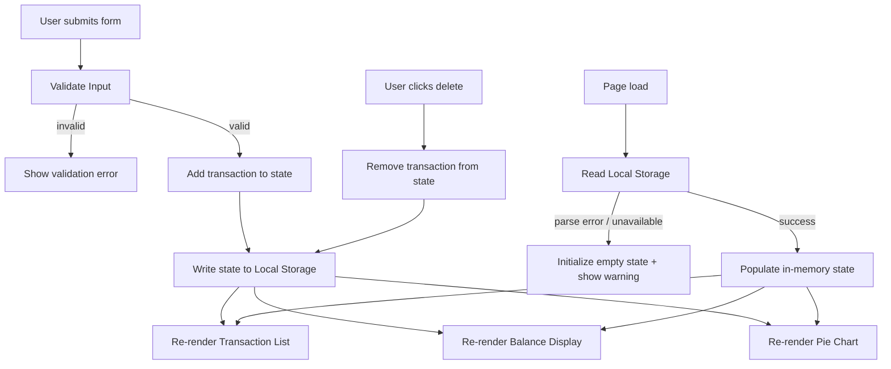

# Design Document

## Overview

The Expense & Budget Visualizer is a fully client-side, single-page web application built with HTML, CSS, and Vanilla JavaScript. It allows users to record personal expenses by category, view a running total balance, and understand their spending distribution through an interactive pie chart. All data is stored and retrieved via the browser's Local Storage API, requiring no server or build toolchain.

The application is delivered as three files: `index.html`, `css/style.css`, and `js/app.js`. Chart rendering is delegated to [Chart.js](https://www.chartjs.org/) loaded from a CDN, which is the only external dependency.

---

## Architecture

The application follows a **unidirectional data flow** pattern, entirely contained within the browser:

```
User Action → Input Validation → State Mutation → Local Storage Sync → UI Render
```

There is no routing, no module bundler, and no framework. All logic lives in `js/app.js`, which is organized into three conceptual layers:

1. **Storage Layer** — reads and writes the transaction list to/from Local Storage as a JSON string.
2. **State Layer** — holds the in-memory transaction array; all mutations go through dedicated functions that also trigger a storage write and a UI refresh.
3. **UI Layer** — DOM manipulation functions that re-render the transaction list, balance display, and pie chart from the current in-memory state.



---

## Components and Interfaces

### 1. StorageService

Responsible for all Local Storage interactions. Isolated so the rest of the app never touches `localStorage` directly.

```js
StorageService.load()         // → Transaction[] | null
StorageService.save(list)     // → boolean (false if quota/unavailable)
StorageService.isAvailable()  // → boolean
```

- `load()` returns `null` on parse error, quota error, or if Local Storage is unavailable.
- `save()` returns `false` if the write fails; callers must surface an error message to the user.

### 2. State

A plain in-memory object holding the single source of truth.

```js
const state = {
  transactions: []  // Transaction[]
};
```

Mutation functions:

```js
addTransaction(transaction)    // validates, pushes to state, saves, renders
deleteTransaction(id)          // filters state, saves, renders
```

### 3. InputForm

DOM component bound to `#expense-form`.

- Reads `#item-name` (text), `#amount` (number), `#category` (select).
- Validates on submit; shows inline error messages for each invalid field.
- On success, calls `addTransaction()` and resets all fields.

### 4. TransactionList

DOM component bound to `#transaction-list`.

```js
renderTransactionList(transactions)
```

- Sorts transactions by `date` descending before rendering.
- Renders each transaction as a list item with item name, formatted amount, category, date, and a delete button.
- Shows an empty-state message when `transactions` is empty.

### 5. BalanceDisplay

DOM component bound to `#balance-display`.

```js
renderBalance(transactions)
```

- Sums all transaction amounts and formats to 2 decimal places.
- Shows `0.00` when the list is empty.
- Shows an error message if the state indicates a storage read failure.

### 6. PieChart

DOM component bound to `#pie-chart-canvas` (a `<canvas>` element).

```js
renderPieChart(transactions)
```

- Groups transactions by category and sums amounts per category.
- Passes the resulting labels and data arrays to Chart.js.
- Destroys and recreates the Chart.js instance on each render to avoid stale data.
- Shows a placeholder text overlay when `transactions` is empty.

### 7. AppController

Bootstraps the application.

```js
init()  // loads from storage, sets state, calls all render functions
```

Runs on `DOMContentLoaded`.

---

## Data Models

### Transaction

```js
{
  id: string,        // UUID v4, generated at creation time (crypto.randomUUID())
  itemName: string,  // 1–100 characters
  amount: number,    // positive float, range 0.01–999999999.99
  category: string,  // "Food" | "Transport" | "Fun"
  date: string       // ISO 8601 date-time string (new Date().toISOString())
}
```

### Local Storage Schema

Key: `"expense_transactions"`  
Value: JSON-serialized `Transaction[]`

```json
[
  {
    "id": "550e8400-e29b-41d4-a716-446655440000",
    "itemName": "Lunch",
    "amount": 12.50,
    "category": "Food",
    "date": "2025-01-15T12:34:56.789Z"
  }
]
```

### Validation Rules

| Field     | Rule                                                        |
|-----------|-------------------------------------------------------------|
| itemName  | Required; string; 1–100 characters after trim              |
| amount    | Required; numeric; 0.01 ≤ value ≤ 999,999,999.99           |
| category  | Required; must be one of "Food", "Transport", "Fun"         |

### Category Spending Summary (derived, not stored)

```js
{
  Food: number,       // sum of amounts for Food transactions
  Transport: number,  // sum of amounts for Transport transactions
  Fun: number         // sum of amounts for Fun transactions
}
```

---

## Correctness Properties

*A property is a characteristic or behavior that should hold true across all valid executions of a system — essentially, a formal statement about what the system should do. Properties serve as the bridge between human-readable specifications and machine-verifiable correctness guarantees.*

### Property 1: Serialization round-trip preserves transactions

*For any* list of valid Transaction objects, serializing the list to JSON and then deserializing it back should produce a list that is deeply equal to the original.

**Validates: Requirements 5.1, 5.2, 5.3, 5.4**

---

### Property 2: Whitespace and invalid item names are rejected

*For any* string composed entirely of whitespace characters (spaces, tabs, newlines), or any string of length zero, submitting it as an item name SHALL prevent a transaction from being added, leaving the transaction list unchanged.

**Validates: Requirements 1.3**

---

### Property 3: Out-of-range amounts are rejected

*For any* numeric value that is less than 0.01 or greater than 999,999,999.99, or that is non-numeric, submitting it as an amount SHALL prevent a transaction from being added, leaving the transaction list unchanged.

**Validates: Requirements 1.4**

---

### Property 4: Balance equals sum of all transaction amounts

*For any* list of transactions, the balance displayed by `renderBalance` SHALL equal the arithmetic sum of all `amount` fields, formatted to exactly 2 decimal places.

**Validates: Requirements 3.1, 3.2, 3.3, 3.4**

---

### Property 5: Adding a transaction grows the list by exactly one

*For any* valid transaction and any existing transaction list, calling `addTransaction` SHALL result in a list whose length is exactly one greater than the original, and the new list SHALL contain the added transaction.

**Validates: Requirements 1.2, 2.1**

---

### Property 6: Deleting a transaction removes exactly that transaction

*For any* transaction list containing at least one transaction, calling `deleteTransaction(id)` SHALL result in a list that contains all original transactions except the one with the matching id, and the length SHALL decrease by exactly one.

**Validates: Requirements 2.5**

---

### Property 7: Pie chart slice percentages sum to 100

*For any* non-empty transaction list, the per-category percentages computed for the Pie_Chart SHALL sum to 100 (allowing for rounding tolerance of ±0.02 per slice × number of categories).

**Validates: Requirements 4.1, 4.6**

---

### Property 8: Category spending aggregation is correct

*For any* transaction list, the sum of all per-category totals used to build the pie chart data SHALL equal the total balance — that is, no transaction amount is omitted or double-counted regardless of category assignment.

**Validates: Requirements 4.1, 4.7**

---

### Property 9: Transactions are sorted by date descending on render

*For any* list of transactions with distinct timestamps, `renderTransactionList` SHALL display them such that each transaction's date is greater than or equal to the date of every transaction that follows it in the rendered output.

**Validates: Requirements 2.2**

---

## Error Handling

| Scenario | Behavior |
|---|---|
| Local Storage unavailable on write | `StorageService.save()` returns `false`; caller shows inline error; transaction is NOT added to state or UI |
| Local Storage unavailable on load | `StorageService.load()` returns `null`; app initializes with empty state; dismissible warning banner shown |
| Local Storage contains malformed JSON | Same as unavailable on load |
| Local Storage data fails structure validation | Same as unavailable on load (each loaded item is validated against the Transaction schema) |
| Delete fails to persist | Transaction remains in state/UI; error message shown to user |
| Browser does not support required APIs (`localStorage`, `crypto.randomUUID`, `DOMContentLoaded`) | App checks for API availability on init; renders a "browser not supported" message and halts |
| Chart.js CDN fails to load | `renderPieChart` checks for `Chart` global; if absent, shows a fallback message in the chart area |

Error messages are rendered as non-modal inline alerts within the relevant UI region. The Local Storage warning on load persists until the user dismisses it via a close button.

---

## Testing Strategy

### Unit Tests (example-based)

Use a test framework compatible with vanilla JS in-browser or Node.js (e.g., [Vitest](https://vitest.dev/) with jsdom).

Focus areas:
- `StorageService.load()` with valid JSON, malformed JSON, and unavailable storage (mocked `localStorage`)
- `StorageService.save()` with quota exceeded error (mocked)
- Input validation: boundary values for `itemName` (length 0, 1, 100, 101) and `amount` (0, 0.01, 999999999.99, 999999999.995, negative, NaN)
- `renderBalance()`: empty list → `"0.00"`, single item, multiple items with floating-point values
- Pie chart percentage computation: single category, all three categories, duplicate category names
- Delete: removing from middle, start, and end of list; non-existent id (no-op)
- Date sort: already sorted, reverse order, identical timestamps

### Property-Based Tests

Use [fast-check](https://fast-check.io/) (browser-compatible, no build step needed via CDN or ESM import).

Each test runs a minimum of **100 iterations**.

| Property | Tag |
|---|---|
| Serialization round-trip | `Feature: expense-budget-visualizer, Property 1: Serialization round-trip preserves transactions` |
| Whitespace/invalid item names rejected | `Feature: expense-budget-visualizer, Property 2: Whitespace and invalid item names are rejected` |
| Out-of-range amounts rejected | `Feature: expense-budget-visualizer, Property 3: Out-of-range amounts are rejected` |
| Balance equals sum | `Feature: expense-budget-visualizer, Property 4: Balance equals sum of all transaction amounts` |
| Add grows list by one | `Feature: expense-budget-visualizer, Property 5: Adding a transaction grows the list by exactly one` |
| Delete removes exactly one | `Feature: expense-budget-visualizer, Property 6: Deleting a transaction removes exactly that transaction` |
| Pie slice percentages sum to 100 | `Feature: expense-budget-visualizer, Property 7: Pie chart slice percentages sum to 100` |
| Category aggregation equals total | `Feature: expense-budget-visualizer, Property 8: Category spending aggregation is correct` |
| Transactions sorted descending | `Feature: expense-budget-visualizer, Property 9: Transactions are sorted by date descending on render` |

### Integration / Browser Tests

Manual or automated (e.g., Playwright) across Chrome, Firefox, Edge, and Safari latest stable:

- Full add → persist → reload → display cycle
- Delete → persist → reload confirms deletion
- Empty state messages in Transaction_List, Balance_Display, and Pie_Chart
- Local Storage disabled (browser private/incognito mode with storage blocked)
- File opened via `file://` protocol
- Chart.js rendering and tooltip display
